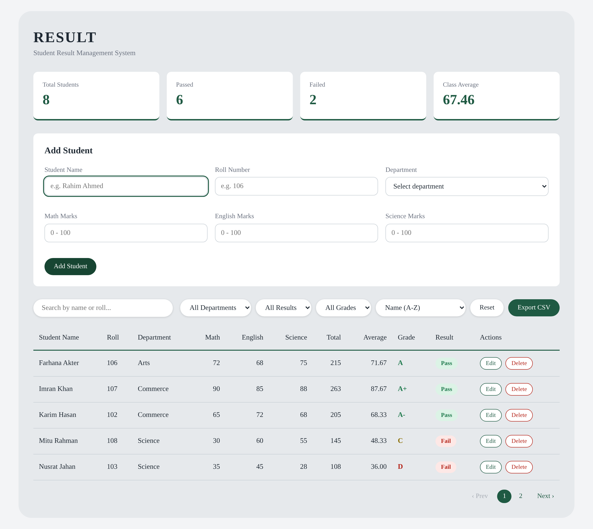
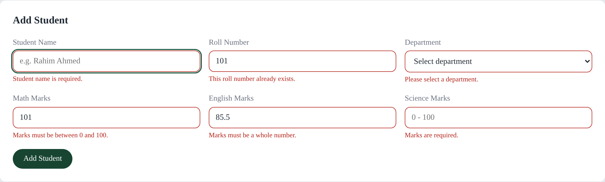
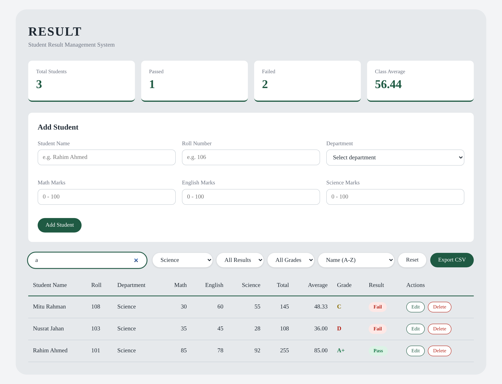
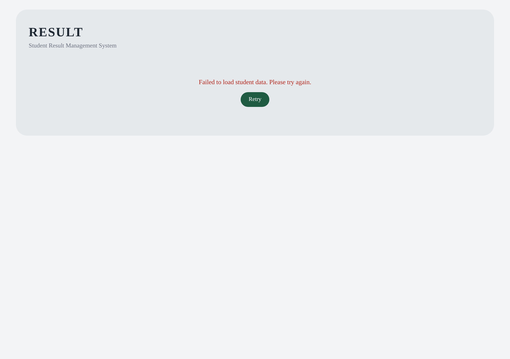
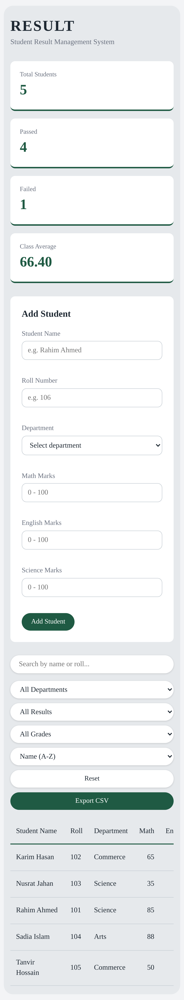

# Student Result Management System

A web app where a teacher can add students, enter marks, calculate results automatically, search, filter, sort and manage student records.

Built with **HTML, CSS and Vanilla JavaScript**. No framework is used. The only external file is the [PapaParse](https://www.papaparse.com/) library (loaded from a CDN), used only to generate the CSV export file.

## Screenshots

| Dashboard, form, table and pagination | Validation errors |
| --- | --- |
|  |  |

| Search and filter working together | Loading error with Retry |
| --- | --- |
|  |  |

| Mobile layout |
| --- |
|  |

## Features

**Records and results**
- Student table rendered dynamically from a JavaScript array (no hand-written rows)
- Automatic total, average, grade and Pass/Fail for every student
- A student passes only with **at least 33 in every subject**, whatever the average is

**Add, edit and delete**
- Add form with validation: all fields required, marks must be whole numbers from 0 to 100, roll numbers must be unique (case-insensitive)
- Validation errors are shown under each field
- Edit loads the student into the form and updates the same record (no duplicate)
- Delete asks for confirmation first
- Unique student ID (highest ID + 1, so IDs never repeat after a delete)

**Search, filter and sort**
- Search by name or roll number, case-insensitive, updates as you type (debounced by 300ms)
- Filters: Department, Result, Grade. They work together with search
- 6 sort options: name A-Z / Z-A, total high-low / low-high, average high-low / low-high
- Reset button clears search, filters, sort and page
- Friendly message when nothing matches

**Dashboard statistics**
- Total students, passed, failed, class average
- Update on add, edit, delete, search and filter

**Extra features**
- **Local Storage:** data stays after a page refresh
- **Pagination:** 5 students per page, Previous/Next and page numbers
- **Export CSV:** downloads the current search/filter/sort result (all pages)
- **Async loading:** data is loaded with a Promise and `setTimeout`, with a loading spinner, an error message and a Retry button
- **Event delegation:** one click listener on the table handles every Edit and Delete button
- **Responsive:** works on desktop and mobile (the table scrolls sideways on small screens)
- **Safe by design:** user text is never inserted with `innerHTML` (see Security)

## Setup Instructions

No installation or build step is needed.

1. Download or clone the project:
   ```
   git clone https://github.com/thats-saidul/student-result-system.git
   cd student-result-system
   ```
2. Open `index.html` in a browser. Or, in VS Code, right-click `index.html` and choose **Open with Live Server**.
3. An internet connection is needed only for **Export CSV** (PapaParse is loaded from a CDN). Everything else works offline.

**Useful for testing**

| What | How |
| --- | --- |
| See the loading error and Retry | Open `index.html?simulateError=true` |
| Go back to the original 5 students | In the browser console run `localStorage.removeItem("studentResultSystem.students")` and refresh |

## Project Structure

```
student-result-system/
├── index.html      page structure (semantic HTML)
├── style.css       design and responsive layout
├── script.js       all logic
├── README.md
└── screenshots/    images used in this README
```

## How the Code Is Organised

`script.js` is split into numbered sections:

| # | Section | What it does |
| --- | --- | --- |
| 1-3 | Constants, initial data, calculation | `calculateTotal`, `calculateAverage`, `getGrade`, `getResult`, `withResult` |
| 4-6 | DOM, rendering, statistics | Build table rows, calculate and show the summary cards |
| 7-8 | Pagination, render the view | Cut the list into pages, redraw table, stats and pagination together |
| 9-10 | Validation, form helpers | Check input, show errors, create student objects |
| 11-13 | Search, filter, sort | Pure functions that take a list and return a new list |
| 14 | Local Storage | Save and load with validation of the saved data |
| 15 | Export CSV | Build and download the CSV file |
| 16 | Debounce | Reusable debounce function |
| 17-18 | Edit and delete, event handlers | Click and form handling |
| 19-20 | Async loading, app start | Promise-based load with loading and error states |

**Data flow.** Raw student data is stored; total, average, grade and result are never stored. They are calculated by `withResult()` each time, so they can never go out of date after an edit.

```
students -> withResult -> search -> filter -> sort -> statistics (whole list)
                                                   \-> pagination (5 per page) -> table
```

## Decisions

- **Class average uses the current view.** The statistics cards follow the search and filters, so filtering to "Science" shows the Science average. With no filter they cover all students. They are not limited to the current page.
- **Marks are whole numbers.** Decimal marks are rejected.
- **Grades** follow the task table. The lowest grade D starts at an average of 33; below that is F. A student can have a D grade but still **Fail** because of a subject below 33.
- **CSV library.** The task asks for only HTML, CSS and Vanilla JavaScript. PapaParse is used only for creating the CSV text, as a conscious exception. Everything else is plain JavaScript.

## Security

- All user-entered text (names, roll numbers) is inserted with `textContent` or `input.value`, never `innerHTML`, so something like `<script>` or `<b>` is shown as plain text.
- Data read back from Local Storage is validated before it is used, so damaged or edited storage cannot crash the app.
- The CSV export uses PapaParse's `escapeFormulae` option, so values starting with `=`, `+`, `-` or `@` cannot run as spreadsheet formulas.

## JavaScript Methods Used

**Arrays**

| Method | Used for |
| --- | --- |
| `map()` | Add results to every student (`withResult`), build CSV rows |
| `filter()` | Search, filter, count passed students |
| `find()` | Find the grade rule, find a student by id |
| `findIndex()` | Find a student's position for update and delete |
| `some()` | Check if a roll number already exists |
| `every()` | Pass check (all subjects at least 33), validate saved data |
| `reduce()` | Total marks, class average, highest id |
| `sort()` | Sort the list (on a copy, made with the spread operator) |
| `slice()` | Cut the current page out of the list |
| `splice()` | Delete a student, replace the contents of the `const` array |
| `push()` | Add a new student |
| `includes()` | Valid department check, text search |
| `forEach()` | Loop over subjects, rows, buttons |

**Strings, numbers and objects**

| Method | Used for |
| --- | --- |
| `trim()`, `toLowerCase()` | Clean input, case-insensitive search and roll check |
| `localeCompare()` | A-Z and Z-A name sort |
| `toFixed(2)` | Show averages with 2 decimals |
| `Number()`, `Number.isNaN()`, `Number.isInteger()` | Convert and validate marks |
| `Math.max()`, `Math.min()`, `Math.ceil()`, `Math.abs()` | New id, page limits, page count, page numbers |
| `Object.keys()`, `Object.entries()`, `Object.assign()` | Loop and reset objects |
| Spread `...` and rest `...args` | Copy objects and arrays, debounce arguments |
| `JSON.stringify()`, `JSON.parse()` | Save and load from Local Storage |

**DOM and browser**

| Method | Used for |
| --- | --- |
| `getElementById()`, `querySelector()` | Find elements once at the start |
| `createElement()`, `appendChild()`, `replaceChildren()` | Build and redraw table rows safely |
| `createDocumentFragment()` | Add all rows at once (faster) |
| `classList.add/remove/toggle()` | Show and hide things, change styles |
| `dataset` | Store `data-action`, `data-id`, `data-page` on buttons |
| `addEventListener()`, `event.target.closest()`, `preventDefault()` | Events and event delegation |
| `localStorage.setItem/getItem()` | Keep data after refresh |
| `confirm()`, `alert()` | Delete confirmation, empty-export message |
| `setTimeout()`, `clearTimeout()` | Debounce and simulated loading delay |
| `new Promise()`, `async/await`, `try/catch` | Simulated data loading with error handling |
| `Blob`, `URL.createObjectURL()`, `URL.revokeObjectURL()` | Download the CSV file |
| `URLSearchParams` | Read `?simulateError=true` |
| `Papa.unparse()` | Create the CSV text (PapaParse) |

## Author

Md Saidul Islam  
GitHub: [thats-saidul](https://github.com/thats-saidul)